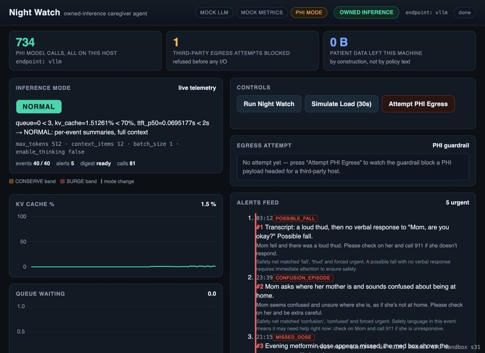
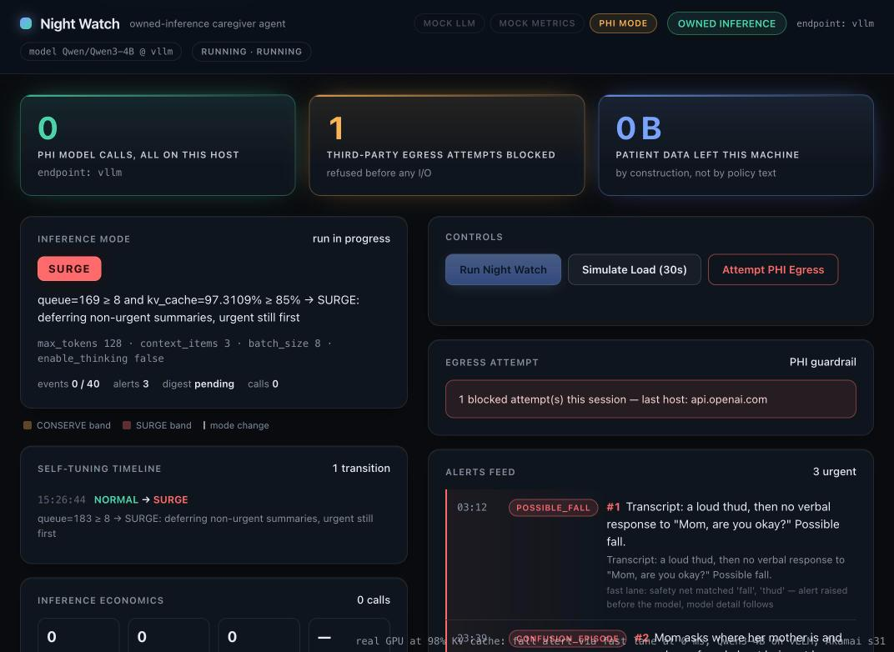
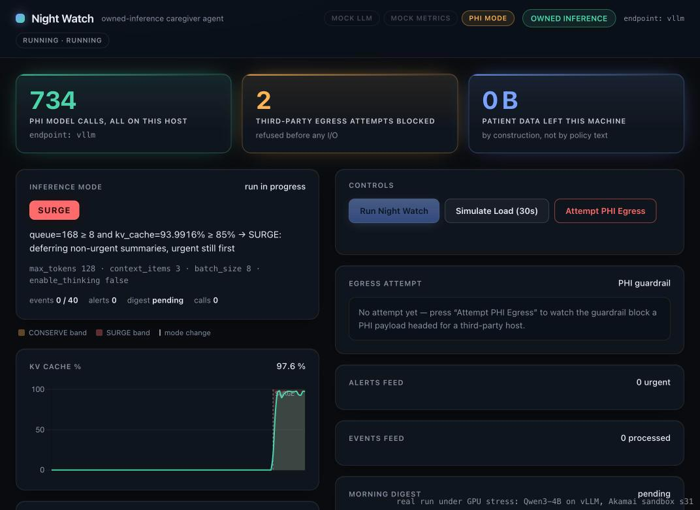

# Nod First Private Night Watch

An **owned-inference** elder-care agent. Overnight it reads 40 synthetic check-in events for
Mom (Ludmila, 81) — a missed evening dose, bathroom trips, a confusion episode, a loud thud at
**03:12** with no verbal response, sibling messages — and writes a morning digest with
owner-assigned tasks for her children, **Anna** and **Pavel**, urgent alerts first.

Built for the HackerSquad + Akamai hackathon _Build AI agents that own their inference_
(AWS Builder Loft, SF · Mon Oct 12 2026). The model is served by vLLM on an Akamai Cloud (Linode)
instance we provision ourselves — Qwen3-4B on a GPU plan, or Qwen3-1.7B on vLLM's CPU build when
GPU quota is unavailable.

**Real GPU run (on site, Oct 12):** Qwen3-4B on vLLM in the Akamai GPU sandbox (Nvidia RTX Pro
4000): 40/40 events, 5 urgent alerts with the 03:12 possible fall first, every PHI call on the
`vllm` host, 1 third-party egress attempt blocked, 0 bytes out. Time to first token ~0.07 s; a
30 s load burst left KV cache at 1.5 %, so the policy correctly stayed `NORMAL` (on our CPU box the
same agent stepped SURGE → CONSERVE). Screenshot: `docs/dashboard-gpu.jpg`.



**Real GPU under stress:** `scripts/gpu_stress.py` held 192 concurrent long, non-PHI completions
against the same vLLM for 100 s (456 completed, 0 errors; peak KV cache 98.2 %, 181 waiting). The
agent read that straight from vLLM `/metrics` and switched itself to **SURGE**
(`queue=168 ≥ 8 and kv_cache=94 % ≥ 85 %`): max_tokens 512 → 128, context 12 → 3 items, batch 1 → 8,
non-urgent summaries deferred, urgent alerts still first. Screenshot: `docs/dashboard-gpu-surge.jpg`.
The Night Watch run started inside that storm still finished 40/40 once the queue drained, with all
three safety-critical alerts intact (03:12 fall first, then the confusion episode and the missed dose).
It flagged one bathroom trip instead of two: those are borderline calls left to the model, not the
keyword safety net, and the smaller SURGE budget made it more conservative.

**Urgent fast lane (built on site from that measurement).** In the storm above, alerts only
appeared once the queue drained. Now every run pre-scans all events with the deterministic safety
net and publishes urgent alerts before the first model call; the model enriches them in place.
Re-run on the real GPU at 98 % KV cache with 169 requests waiting: the **03:12 fall alert was
raised at 0 ms** (`fast_lane: true`, `raised_ms: 0`) while the model had processed 0 of 40 events.
Screenshot: `docs/dashboard-gpu-fastlane.jpg`.



**Urgent-recall eval on the real GPU** (`eval/run_eval.py`, Qwen3-4B on vLLM, 20 labeled events):

| Mode | Urgent recall | Calls | Tokens | Wall time |
|---|---|---|---|---|
| NORMAL | 1.000 | 41 | 16,794 | 45.3 s |
| SURGE | 1.000 | 26 | 5,848 (−65 %) | 24.2 s (−47 %) |



It owns its inference in three visible ways: a **PHI egress guardrail**, a **self-tuning loop**
driven by the agent's own vLLM telemetry, and a **live inference dashboard**. Nothing leaves the
machine, and every step is deterministic offline in mock mode.

## Why own inference: elder health data stays on our GPU on Akamai Cloud

Families today send Mom's sleep, medication, and fall data to someone else's API. Here the
caregiver agent runs its model on infrastructure we control, and the privacy rule is enforced in
code, not in a policy document:

- **Every completion is wrapped by `core/egress_guard.py`.** A payload tagged `phi=True` may only
  reach a host in `EGRESS_ALLOWLIST` (the owned vLLM). Any other host raises `EgressBlocked`
  **before a single byte leaves the process** — the dashboard's `Attempt PHI Egress` button shows
  that block live (`api.openai.com`, 0 bytes egressed).
- **The endpoint choice is visible at runtime.** The header badge reads `OWNED INFERENCE` when the
  configured endpoint is allowlisted, warns `NON-OWNED ENDPOINT — non-PHI only` when it is not, and
  shows the neutral `MOCK — no egress possible` while mock mode is on.
- **The DigitalOcean fallback is config-only.** `FALLBACK_BASE_URL` is parsed and displayed, and no
  code path in this repo ever calls it (budget rule: the repo makes **no** outbound inference calls
  during the build — mock mode only). See "Submission hygiene".

Self-hosting an elder-care agent is also the reason the agent can adapt to its own server: the
same process that holds the PHI reads the GPU's telemetry and decides how much inference to spend.

## Architecture

The pipeline, the guard it must pass, and the self-tuning loop that decides how much inference
each step may spend:

```
  nightwatch/dataset.py — 40 synthetic events (Mom, Ludmila 81; seed 42, offline)
        │   missed metformin 21:15 · confusion 23:39 · possible fall 03:12 · sibling messages
        ▼
┌──────────────────────────────────────────────────────────────────────────────┐
│ nightwatch/pipeline.py — NightWatchRun                                        │
│  1. classify every event  (structured JSON + one repair retry + keyword net)   │
│  2. order for processing: URGENT first in EVERY mode (fall → confusion → dose) │
│  3. summarize per policy mode:                                                 │
│       NORMAL   one call per event (max_tokens 512, context 12)                 │
│       CONSERVE batched summaries, shorter context (256 / 6, batches of 4)      │
│       SURGE    urgent go one-by-one, non-urgent DEFER into one batch (128 / 3) │
│  4. nightwatch/digest.py — morning digest, Anna + Pavel tasks, deferred note    │
│  5. log every call: mode, latency, prompt/completion tokens, ok/error          │
└───────────────┬──────────────────────────────────────────────────────────────┘
                ▼   every completion passes through the guard first
┌──────────────────────────────────────────────────────────────────────────────┐
│ core/llm.py           LLMClient — env-driven OpenAI SDK + deterministic mock   │
│ core/egress_guard.py  phi=True → EGRESS_ALLOWLIST hosts only,                 │
│                       else EgressBlocked BEFORE any network I/O               │
│ core/agent.py         caregiver persona + JSON tool protocol + in-memory store │
└───────────────▲──────────────────────────────────────────────────────────────┘
                │   ModeParams(max_tokens, context_items, batch_size, enable_thinking)
┌───────────────┴──────────────────────────────────────────────────────────────┐
│ the self-tuning loop                                                          │
│ inference/metrics.py  poll VLLM_METRICS_URL every 2s → snapshot()             │
│                       (waiting, running, kv_cache_pct, ttft_p50, tokens/s)    │
│ inference/policy.py   choose_mode(snapshot) → NORMAL | CONSERVE | SURGE       │
│                       + params + a human-readable reason, from config         │
│      thresholds (config.py):                                                  │
│        CONSERVE  waiting ≥ 3  OR kv ≥ 70%  OR ttft_p50 ≥ 2.0s                 │
│        SURGE     waiting ≥ 8  OR kv ≥ 85%  OR ttft_p50 ≥ 5.0s                 │
│        NORMAL    everything below both sets                                   │
└──────────────────────────────────────────────────────────────────────────────┘
        ▲
scripts/load.py — N concurrent requests against the real endpoint (on site);
                  tonight it drives the synthetic load curve via the app API

app/app.py (FastAPI) + app/dashboard.html (vendored Chart.js 4.5.1, zero external URLs)
mcp/ — the agent tools over a stdio FastMCP server   ·   eval/ — urgent recall, NORMAL vs SURGE
```

**How the loop closes.** The pipeline asks the policy for a decision before every step, and the
policy reads the metrics source that polls the agent's own vLLM server. Under load the mode walks
`NORMAL → CONSERVE → SURGE` with a reason naming the observed numbers (`queue=9 waiting ≥ 8 →
SURGE: deferring non-urgent summaries, urgent still first`), the next step uses the new params
(the call log shows mixed modes mid-run), then the curve decays and the badge returns to `NORMAL`.
Urgent alerts jump the queue in every mode, and `eval/run_eval.py` proves urgent recall stays
**1.000** under NORMAL *and* under SURGE (while SURGE spends roughly a third of the tokens).

**Why JSON, not tool calls.** Qwen3-4B is unreliable with SDK tool-calling, so every structured
step asks for JSON, extracts the first balanced object, retries once with a repair instruction,
and falls back to a canned summary instead of crashing. Every completion sends
`enable_thinking=False` and strips any ` thinking` block.

### HTTP surface (port 8765)

| Endpoint | What it returns |
|---|---|
| `GET /` | the dashboard (single static page, no build step) |
| `POST /api/run` | starts a Night Watch run in the background (`409` if one is active) |
| `GET /api/status` | run state, current mode + reason + params, egress state, flags, counters |
| `GET /api/metrics` | latest telemetry snapshot + history for the charts |
| `GET /api/events?since=<n>` | incremental event feed (exclusive 1-based cursor) |
| `GET /api/alerts` | urgent alerts in emit order (the 03:12 fall first) |
| `GET /api/digest` | `{ready: false}` until the run finishes, then the digest + markdown |
| `GET /api/calls` | the full LLM call log (mode, latency, tokens, ok/error) |
| `POST /api/simulate-load` | `{duration_s: 30, intensity: 1.0}` → drives the load curve |
| `POST /api/egress-demo` | attempts a `phi=True` call to a third-party host → blocked, 0 bytes |

## The 2-minute demo

1. **0:00 — privacy.** Open the dashboard, press **Attempt PHI Egress**. The panel turns red:
   `EgressBlocked: api.openai.com not in allowlist`, bytes egressed `0`. "Families send Mom's
   health data to someone else's API. This agent runs on its own GPU."
2. **0:25 — the night watch.** Press **Run Night Watch**. Events stream in, and the **03:12
   possible fall** alert surfaces **first**, ahead of the earlier missed dose (21:15) and the
   confusion episode (23:39) — urgency beats timestamps. The call log fills with mode, latency, and
   tokens per call.
3. **0:50 — self-tuning.** Press **Simulate Load (30s)**. KV-cache % and queue depth climb; the
   mode badge walks `CONSERVE → SURGE` with its reason on screen; the call log shows the step
   params changing mid-run; urgent processing is unaffected.
4. **1:25 — the digest.** The morning digest: **Anna** — call Mom's doctor about the missed
   metformin dose; **Pavel** — check the bathroom night light and the trip hazard by the rug. If
   SURGE deferred anything, the digest lists those items explicitly.
5. **1:45 — the close.** "vLLM and Qwen3-4B on an Akamai GPU, an agent that reads its own server's
   telemetry. The same core runs against any OpenAI-compatible endpoint."

## Live demo tips (measured during validation)

- **Click Simulate Load immediately after Run Night Watch** — not "mid-run". Two effects stack up:
  the **CONSERVE frame on the way up lasts only ~2 s**, and a run that is already under SURGE
  **finishes in ~2–4 s** instead of ~12–18 s, because SURGE collapses all remaining non-urgent
  summaries into one deferred batch. Click Run, then click Load in the same breath, and watch the
  badge rather than the event counter.
- Mode recovery is not instant: the mock curve decays back to baseline within ~15 s of the load
  window ending, and the badge returns to `NORMAL` roughly **8 s after the window closes** — give
  it ~45–60 s before asserting recovery on stage or in a validator.
- `/api/metrics` history is a bounded rolling buffer: **300 samples**, which is ~10 minutes at the
  2 s poll tick. Once it is saturated the length stays pinned at 300 while the content keeps
  sliding — the payload is live, not frozen.
- A **fresh run resets** events, alerts, calls, and the digest. Pressing Run again after a finished
  run is the clean way to replay the demo.

## Quick start (mock mode, offline)

Mock mode is a first-class feature here, not a stub: canned deterministic LLM replies plus a
synthetic load curve make the whole demo reproducible with no GPU, no network, and no credentials.

```bash
uv sync                                   # Python 3.12 + pinned deps (uv manages the venv)
cp .env.example .env                      # mock-only defaults: LLM_BASE_URL=mock, VLLM_METRICS_URL=mock
uv run uvicorn app.app:app --host 127.0.0.1 --port 8765
```

Then open <http://127.0.0.1:8765>. You should see the flags `MOCK LLM`, `MOCK METRICS`, `PHI MODE`,
the neutral privacy badge `MOCK — no egress possible`, and the mode badge on `NORMAL`.

The three buttons:

| Button | What it does |
|---|---|
| **Run Night Watch** | streams the 40 overnight events through the pipeline; alerts first, then the digest |
| **Simulate Load (30s)** | drives the synthetic telemetry curve so the mode walks CONSERVE → SURGE → NORMAL |
| **Attempt PHI Egress** | sends a `phi=True` payload at a third-party host and shows the guard blocking it |

Stop the server with `kill $(lsof -ti :8765)`.

## Other commands

```bash
uv run pytest -q                          # full suite (in-process ASGI, no ports, no network)
uv run ruff check .                       # lint
uv run python scripts/demo.py             # scripted console demo: alerts, digest, call log
uv run python scripts/load.py --duration 30 --intensity 1.0 --n 8
uv run python eval/run_eval.py            # urgent recall under NORMAL vs SURGE (exits non-zero on a miss)
uv run python -m mcp                      # agent tools over a stdio MCP server
```

`scripts/demo.py` uses the running app when it is up and otherwise runs the pipeline in-process;
`eval/run_eval.py --inject-failure` flips one known-urgent classification to prove the eval gate
actually fires (recall drops, exit code non-zero).

## Environment variables

All of these are read by `config.py` (the single source of env parsing and policy thresholds —
nothing else in the repo touches `os.environ`), and `.env.example` lists exactly these names.

| Variable | Tonight (mock) | On site (Akamai sandbox) |
|---|---|---|
| `LLM_BASE_URL` | `mock` | `http://<sandbox-host>:8000/v1` |
| `LLM_API_KEY` | `EMPTY` | `EMPTY` (vLLM accepts any unless `--api-key` is set) |
| `LLM_MODEL` | `Qwen/Qwen3-4B` | the id from `GET /v1/models` — never hardcode it |
| `VLLM_METRICS_URL` | `mock` | `http://<sandbox-host>:8000/metrics` |
| `EGRESS_ALLOWLIST` | `localhost,127.0.0.1` | `<sandbox-host>` — the only host PHI may reach |
| `FALLBACK_BASE_URL` | `https://inference.do-ai.run/v1` | same (documented, **config-only**, never called by code) |
| `PHI_MODE` | `true` | `true` |
| `PORT` | `8765` | `8765` |
| `MOCK_FAIL_RUN` | unset (`0`) | leave unset; `1` makes a started run fail on purpose (demo facility) |
| `POLICY_CONSERVE_WAITING` | `3` | `3` |
| `POLICY_CONSERVE_KV` | `0.70` | `0.70` |
| `POLICY_CONSERVE_TTFT` | `2.0` | `2.0` |
| `POLICY_SURGE_WAITING` | `8` | `8` |
| `POLICY_SURGE_KV` | `0.85` | `0.85` |
| `POLICY_SURGE_TTFT` | `5.0` | `5.0` |

The six `POLICY_*` overrides and `MOCK_FAIL_RUN` are commented out in `.env.example`, so the
documented defaults apply; `.env` itself is gitignored and never committed.

## On-site env swap checklist (Akamai sandbox, Mon Oct 12)

The whole point of the mock-first build: **swapping to the real GPU is configuration, not code.
No code changes.** Pick up the access card, open JupyterLab (the GPU is already serving vLLM),
and do this in a terminal there:

1. **Find the endpoint and the model id.**
   ```bash
   curl -s $VLLM_HOST/v1/models | jq '.data[].id'
   ```
2. **Set the five sandbox values** — in `.env`, alongside the existing ones (no code edits):
   ```bash
   LLM_BASE_URL=http://<sandbox-host>:8000/v1
   LLM_MODEL=<id from GET /v1/models>          # never hardcode the model
   VLLM_METRICS_URL=http://<sandbox-host>:8000/metrics
   EGRESS_ALLOWLIST=<sandbox-host>             # PHI is allowed to reach this host and no other
   PHI_MODE=true
   ```
3. **Verify the metrics endpoint** (metric names differ across vLLM versions; the parser is
   sample-name-driven and tolerates missing names by leaving fields `None`):
   ```bash
   curl -s $VLLM_METRICS_URL | grep -E 'num_requests_waiting|gpu_cache_usage|time_to_first_token' | head
   ```
4. **Restart the app** with the same command as mock mode and load the dashboard:
   ```bash
   uv run uvicorn app.app:app --host 127.0.0.1 --port 8765
   ```
   Expected: the privacy badge flips from `MOCK — no egress possible` to **`OWNED INFERENCE`**,
   `PHI MODE` stays lit, the mode badge shows a real reason quoting live queue/KV/ttft numbers,
   and the charts move when you press **Simulate Load** (that path fires real concurrent
   completions at the endpoint).
5. **Re-run the demo and capture the submission screenshot** of the dashboard against the real
   sandbox endpoint (the committed `docs/dashboard-mock.png` is the mock-mode stand-in).
6. **Testing on site needs the mock configuration.** `uv run pytest -q` includes a config test that
   asserts the mock defaults read from `.env` (`LLM_BASE_URL=mock`, `VLLM_METRICS_URL=mock`), and
   it parses `.env` directly — exporting shell variables will not override the file. Before running
   the suite, keep the mock values in `.env`, or swap files:
   ```bash
   cp .env .env.onsite      # keep the sandbox values
   cp .env.example .env     # restore the committed mock template
   uv run pytest -q         # or: run ruff check . (no env dependency)
   cp .env.onsite .env      # back to the sandbox endpoint for the demo
   ```
   (`.env` and local copies like `.env.onsite` are gitignored, so the sandbox values never land
   in the repo.)

## Submission hygiene

- **No secrets tracked.** `.env` and local copies (`.env.*`, e.g. `.env.onsite`) are gitignored
  and verifiably untracked; `.env.example` is the committed template and lists exactly the
  variables `config.py` reads. No API key, no sandbox host, no sandbox password is committed.
- **The fallback host is documentation only.** `inference.do-ai.run` appears as
  `FALLBACK_BASE_URL` in `.env.example` and in this README; no Python module, page, or script
  references it, and nothing calls it.
- **No outbound inference from this repo during the build.** Every dev, test, and validation run
  is mock mode (`LLM_BASE_URL=mock`, `VLLM_METRICS_URL=mock`); the egress demo raises before any
  network I/O. The dashboard is fully offline: Chart.js 4.5.1 is vendored at
  `app/static/chart.umd.js` and the page issues zero non-localhost requests.
- **Deterministic.** Dataset seed 42 plus canned replies means the same events, alerts, and digest
  on every run — reproducible for judges, and the Wi-Fi-death insurance for the live demo.
- **Clean tree at handoff.** All work is committed; `git status --short` is empty.
- **Screenshots.** `docs/dashboard-gpu.jpg` — real run on the Akamai GPU sandbox (Qwen3-4B, vLLM),
  captured with `scripts/gpu_demo_snapshots.sh` + `scripts/inline_snapshot.py` because the sandbox
  only exposes JupyterLab. `docs/dashboard-owned-cpu.jpg` — the dashboard after a real 40-event run against
  our own Linode vLLM box (Qwen3-1.7B, CPU build; 55 calls, 0 errors, policy stepped SURGE → CONSERVE
  on live TTFT). `docs/dashboard-mock.png` — the same dashboard in offline mock mode.

## Own box on Akamai Cloud (no sandbox needed)

`deploy/` holds two cloud-init files for a Linode that serves vLLM bound to **localhost only**;
you reach it through an SSH tunnel, so PHI never crosses the public internet:

- `deploy/linode-gpu-cloud-init.yaml` — RTX 4000 Ada plan, Qwen3-4B (needs GPU quota on the account).
- `deploy/linode-cpu-cloud-init.yaml` — any Shared/Dedicated plan with ≥ 16 GB RAM, Qwen3-1.7B on
  vLLM's CPU image. Slow (≈ 8 s per classification) but real `/metrics`, which is exactly what makes
  the SURGE/CONSERVE transitions visible.

Then, with no env-file edits:

```bash
ssh -N -L 8000:127.0.0.1:8000 root@<linode-ip>
LLM_BASE_URL=http://127.0.0.1:8000/v1 LLM_MODEL=<id from /v1/models> \
  VLLM_METRICS_URL=http://127.0.0.1:8000/metrics uv run uvicorn app.app:app --host 127.0.0.1 --port 8765
```

Known limit of the 1.7B model: summaries occasionally borrow details from neighbouring events in
the context window. The keyword safety net still forces the correct severity; the 4B GPU path
fixes the wording.

## Prep disclosure

Per the **build-on-site rule**, this must be stated plainly: **the code in this repo was written
ahead of the event, on Sunday night Oct 11 through the small hours of Monday Oct 12** (first
commit 23:44 PT, last prep commit 06:19 PT). That preparation is disclosed here and in the demo.
It was built with an AI coding agent driving a mock-only, offline harness — no outbound inference
calls and no cloud spend at any point. The on-site Loft time goes to the env swap above, the live
sandbox run, and the demo, not to writing the app.

## Credits

- **[akamai-developers/akamai-workshop-ai-inference](https://github.com/akamai-developers/akamai-workshop-ai-inference)**
  — the vLLM performance workshop. Reference for the OpenAI-compatible `/v1` surface and the
  Prometheus `/metrics` exposition this agent polls and tunes against (batching, prefill/decode,
  and the module that puts an agent on the endpoint).
- **[akamai-developers/akamai-workshop-solution-architect-agent](https://github.com/akamai-developers/akamai-workshop-solution-architect-agent)**
  — the solution-architect agent workshop. The MCP tools module is the pattern mirrored by `mcp/`
  here (same agent tools, exposed over a stdio FastMCP server), and its guardrails/evals modules
  informed the egress guard and the urgent-recall eval.
- **Qwen `Qwen/Qwen3-4B`** (thinking mode disabled and stripped) and **vLLM** (OSS) for serving.
- **FastAPI / uvicorn**, **httpx**, **prometheus-client**, **python-dotenv**, **pydantic**,
  **pytest**, **ruff**, and **MCP** (pinned `>=1,<2`).
- **Chart.js 4.5.1** (MIT), vendored for an offline dashboard.
